# RuangKabar

RuangKabar adalah portal berita berbasis web yang dibangun menggunakan Laravel. Aplikasi ini menyediakan layanan membaca berita bagi pengunjung, pengelolaan artikel bagi penulis, serta panel administrasi untuk mengelola konten dan pengguna.

Website: https://ruangkabar.web.id

## Daftar Isi

1. [Gambaran Umum](#gambaran-umum)
2. [Tujuan Pengembangan](#tujuan-pengembangan)
3. [Fitur Utama](#fitur-utama)
4. [Hak Akses Pengguna](#hak-akses-pengguna)
5. [Teknologi](#teknologi)
6. [Struktur Database](#struktur-database)
7. [Relasi Database](#relasi-database)
8. [ERD](#erd)
9. [Dokumentasi Tampilan](#dokumentasi-tampilan)
10. [Persyaratan Sistem](#persyaratan-sistem)
11. [Instalasi dan Konfigurasi](#instalasi-dan-konfigurasi)
12. [Menjalankan Aplikasi](#menjalankan-aplikasi)
13. [Struktur Direktori](#struktur-direktori)

## Gambaran Umum

RuangKabar memiliki halaman publik dan dashboard berdasarkan peran pengguna. Pengunjung dapat membaca, mencari, dan menjelajahi berita berdasarkan kategori. Pengguna terdaftar dapat memberikan komentar, melihat riwayat bacaan, dan mengajukan diri menjadi penulis. Penulis mengelola artikelnya sendiri, sedangkan admin mengelola seluruh konten, pengguna, komentar, dan laporan.

Sistem menggunakan tiga peran, yaitu `admin`, `penulis`, dan `pengguna`, dengan pembatasan akses melalui middleware `RoleMiddleware`.

## Tujuan Pengembangan

- Menyediakan portal berita yang mudah diakses.
- Memfasilitasi penulis dalam mengelola artikel.
- Menyediakan pengelolaan konten dan pengguna bagi admin.
- Menerapkan autentikasi, pembatasan akses, dan moderasi komentar.

## Fitur Utama

| Area | Fitur |
|---|---|
| Publik | Beranda, berita terbaru, pencarian, kategori, dan detail berita |
| Autentikasi | Registrasi, login, logout, dan pengelolaan akun |
| Pengguna | Komentar, balasan, riwayat bacaan, dan pengajuan penulis |
| Penulis | Dashboard, pembuatan, pengubahan, dan penghapusan artikel |
| Admin | Pengelolaan artikel, kategori, tag, komentar, pengguna, dan laporan |
| Moderasi | Pemeriksaan komentar otomatis dan moderasi oleh admin |
| Notifikasi | Pemberitahuan komentar, balasan, dan pengajuan penulis |

Artikel memiliki status `draft` dan `published`. Komentar memiliki status `pending`, `approved`, dan `rejected`. Hanya artikel berstatus `published` yang ditampilkan pada halaman publik.

## Hak Akses Pengguna

### Admin

- Mengelola seluruh artikel, kategori, dan tag.
- Meninjau serta mengelola komentar.
- Mengelola akun, peran, dan status pengguna.
- Menyetujui atau menolak pengajuan penulis.
- Melihat dan mencetak laporan.

### Penulis

- Melihat dashboard dan statistik artikel.
- Membuat, mengubah, dan menghapus artikel miliknya.
- Mengelola kategori, tag, gambar, dan status publikasi artikel.
- Menerima notifikasi dan membalas komentar yang disetujui.

### Pengguna

- Membaca berita dan mengelola akun.
- Menulis komentar dan balasan.
- Melihat riwayat bacaan.
- Mengajukan diri menjadi penulis.
- Menerima notifikasi aktivitas akun dan komentar.

## Teknologi

| Komponen | Teknologi |
|---|---|
| Bahasa pemrograman | PHP `^8.3` |
| Framework | Laravel `^13.17` |
| Database | MySQL |
| Antarmuka | Blade |
| CSS | Tailwind CSS `^4` |
| Build tool | Vite `^8` |
| Autentikasi | Laravel Authentication |
| Notifikasi | Laravel Database Notifications |

## Struktur Database

RuangKabar menggunakan sembilan tabel utama:

| Tabel | Fungsi |
|---|---|
| `users` | Menyimpan data akun, peran, dan status pengguna |
| `categories` | Menyimpan kategori berita |
| `articles` | Menyimpan artikel dan informasi publikasi |
| `comments` | Menyimpan komentar dan balasan |
| `tags` | Menyimpan tag artikel |
| `article_tags` | Menghubungkan artikel dengan tag |
| `author_applications` | Menyimpan pengajuan menjadi penulis |
| `reading_histories` | Menyimpan riwayat bacaan pengguna |
| `notifications` | Menyimpan notifikasi aplikasi |

## Relasi Database

Relasi utama antartabel:

- `users` memiliki banyak `articles` dan `comments`.
- `categories` memiliki banyak `articles`.
- `articles` memiliki banyak `comments`.
- `articles` dan `tags` memiliki relasi many-to-many melalui `article_tags`.
- `comments` dapat memiliki balasan melalui `parent_id`.
- `users` memiliki banyak `author_applications` dan `reading_histories`.
- `notifications` menggunakan relasi polimorfik Laravel.

## ERD

### Entity Relationship Diagram

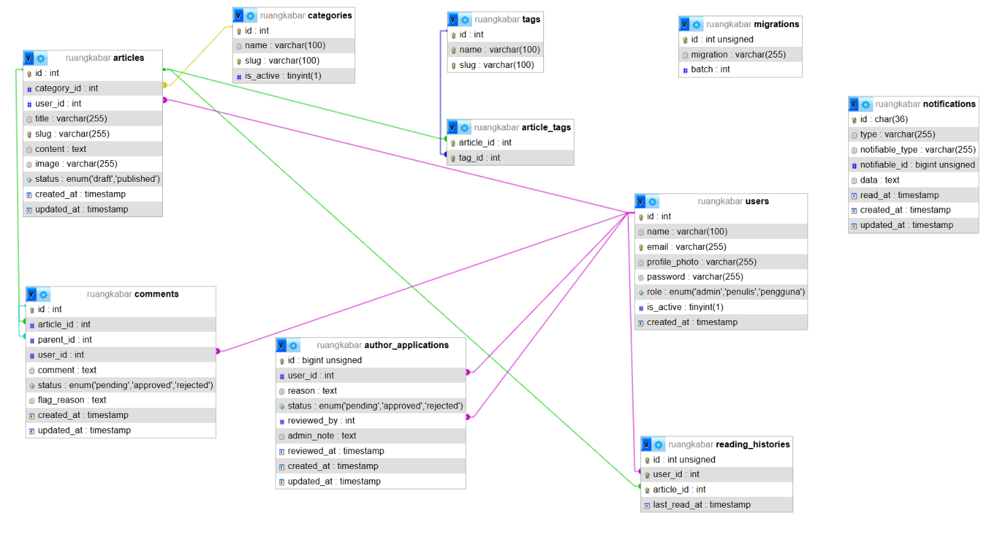

*Gambar 1. Entity Relationship Diagram database RuangKabar.*

## Dokumentasi Tampilan

Seluruh screenshot berikut merupakan dokumentasi antarmuka aplikasi RuangKabar.

### Autentikasi


*Gambar 2. Halaman login.*


*Gambar 3. Halaman registrasi akun.*

### Halaman Publik

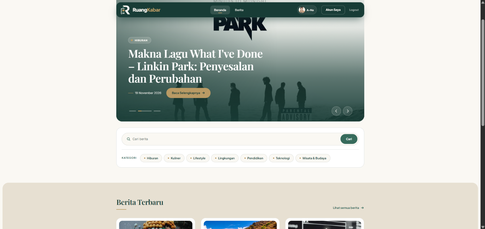

*Gambar 4. Halaman beranda publik.*


*Gambar 5. Halaman daftar berita.*

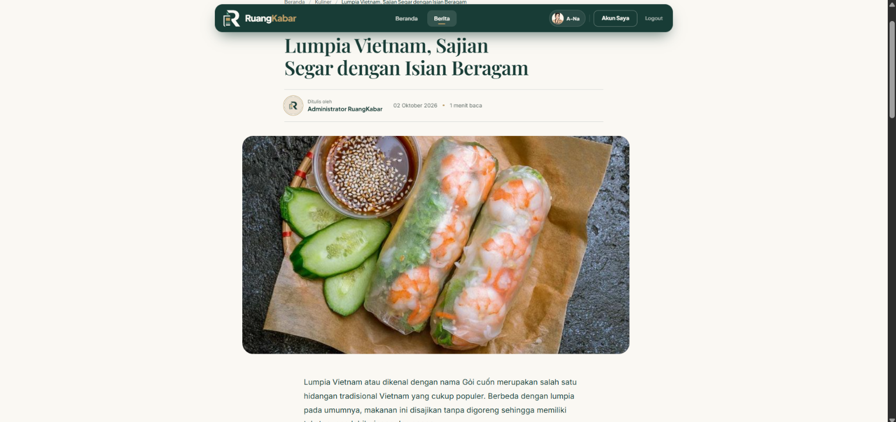

*Gambar 6. Halaman detail artikel.*

### Area Pengguna

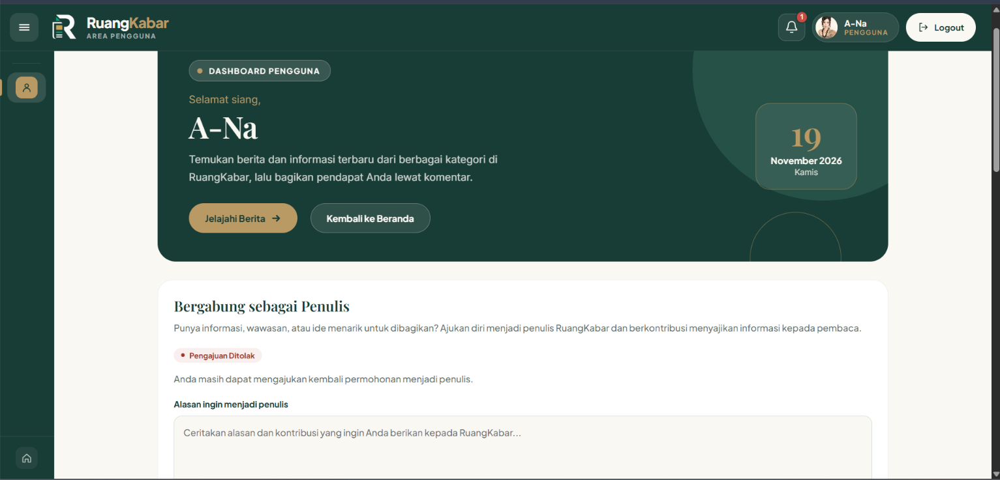

*Gambar 7. Dashboard pengguna.*

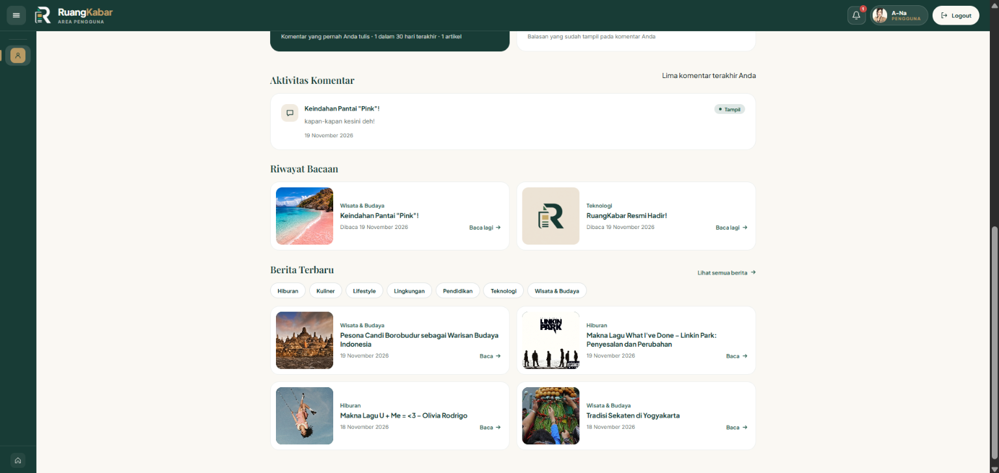

*Gambar 8. Tampilan lanjutan area pengguna.*

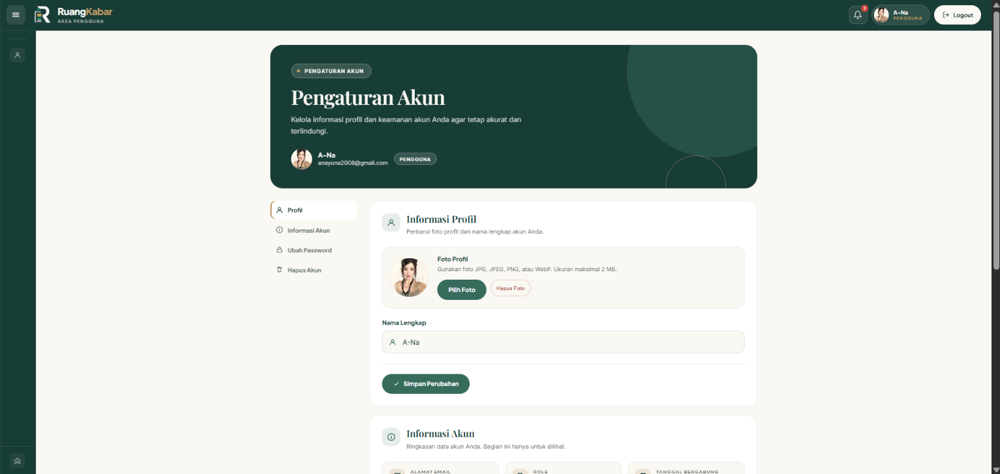

*Gambar 9. Halaman pengaturan akun.*

### Area Penulis

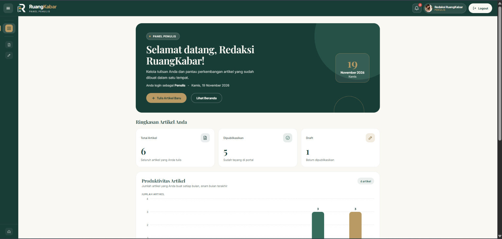

*Gambar 10. Dashboard penulis.*

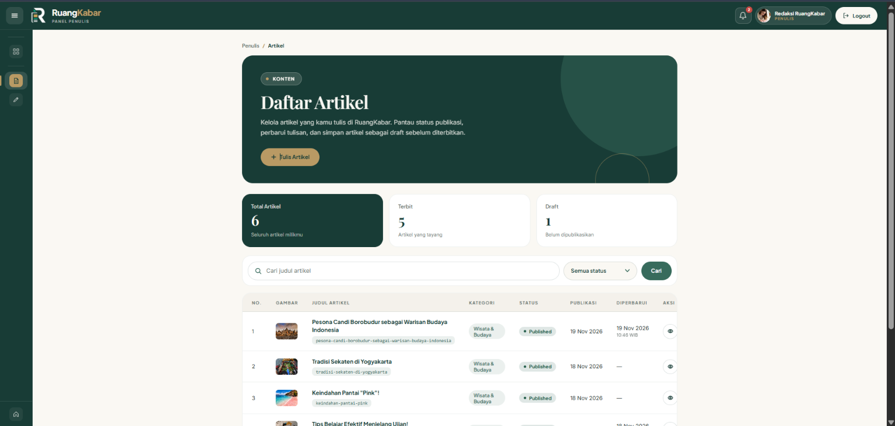

*Gambar 11. Halaman pengelolaan artikel penulis.*

### Area Admin

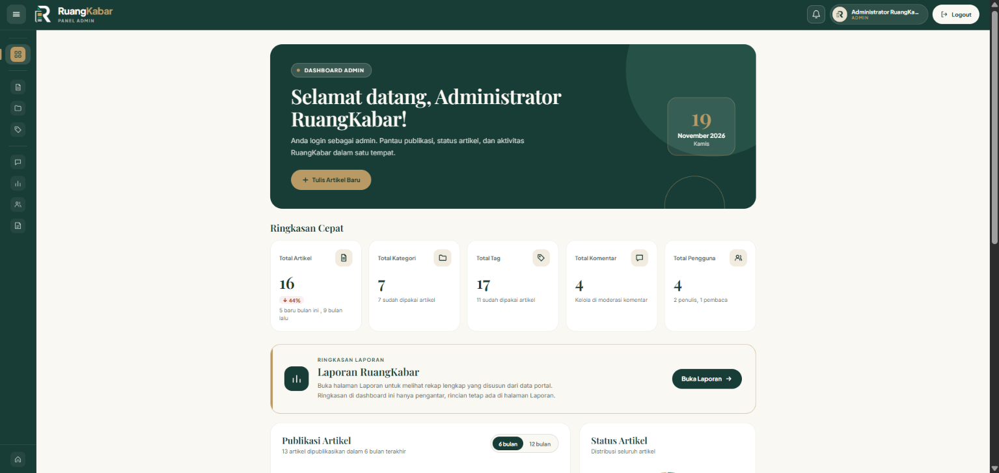

*Gambar 12. Dashboard admin.*

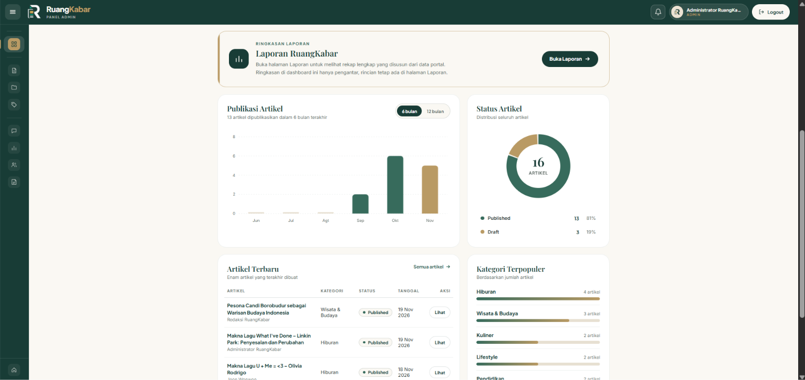

*Gambar 13. Ringkasan statistik dan laporan pada dashboard admin.*

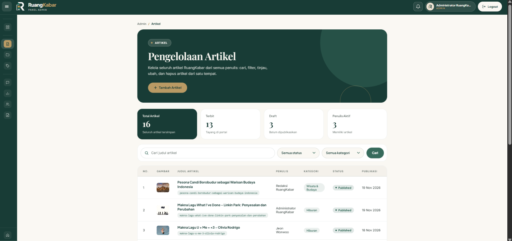

*Gambar 14. Halaman pengelolaan artikel.*

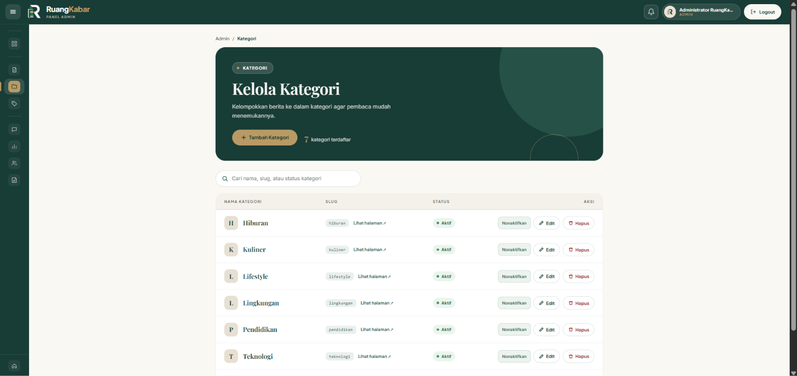

*Gambar 15. Halaman pengelolaan kategori.*


*Gambar 16. Halaman pengelolaan tag.*


*Gambar 17. Halaman moderasi komentar.*

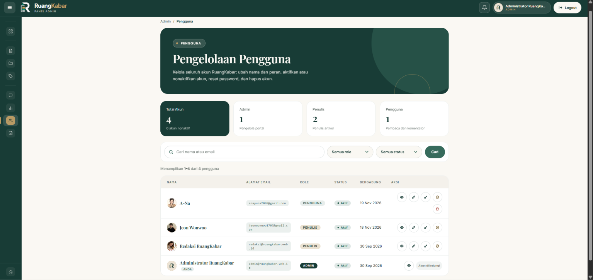

*Gambar 18. Halaman pengelolaan pengguna.*


*Gambar 19. Halaman laporan artikel.*


*Gambar 20. Tampilan lanjutan laporan artikel.*

## Persyaratan Sistem

- PHP 8.3 atau lebih baru.
- Composer.
- Node.js dan npm.
- MySQL atau MariaDB.
- Ekstensi PHP yang dibutuhkan Laravel, termasuk `pdo_mysql` dan `mbstring`.

## Instalasi dan Konfigurasi

### 1. Clone Repository

```bash
git clone (https://github.com/salliemarsha/RuangKabar.git)
cd ruangkabar
```

### 2. Instalasi Dependency

```bash
composer install
npm install
```

### 3. Konfigurasi Environment

Salin `.env.example` menjadi `.env`, kemudian jalankan:

```bash
php artisan key:generate
```

Sesuaikan konfigurasi database pada `.env`:

```dotenv
APP_NAME=RuangKabar
APP_ENV=local
APP_DEBUG=true
APP_URL=http://localhost:8000

DB_CONNECTION=mysql
DB_HOST=127.0.0.1
DB_PORT=3306
DB_DATABASE=ruangkabar
DB_USERNAME=root
DB_PASSWORD=

SESSION_DRIVER=file
CACHE_STORE=file
FILESYSTEM_DISK=public
```

Sesuaikan nama pengguna dan kata sandi database dengan konfigurasi MySQL masing-masing.

### 4. Persiapan Database

Buat database MySQL bernama `ruangkabar`, kemudian impor database yang telah memiliki struktur tabel inti.

**Catatan:** Migration pada repositori ini belum membentuk seluruh tabel inti dari database kosong. Tabel `users`, `articles`, `categories`, `tags`, `comments`, dan `article_tags` perlu tersedia terlebih dahulu dengan struktur yang sesuai sebelum menjalankan migration lanjutan.

Jika database sudah sesuai, jalankan:

```bash
php artisan migrate
```

### 5. Storage Link

```bash
php artisan storage:link
```

Perintah ini diperlukan untuk menampilkan foto profil dan gambar artikel yang disimpan pada disk publik.

## Menjalankan Aplikasi

Jalankan server Laravel:

```bash
php artisan serve
```

Jalankan Vite pada terminal lain:

```bash
npm run dev
```

Akses aplikasi melalui `http://localhost:8000`.

Untuk membangun aset produksi:

```bash
npm run build
```

### Catatan Akun dan Hak Akses

Registrasi melalui aplikasi secara otomatis membuat akun dengan peran `pengguna`. Akun admin dan penulis perlu disiapkan melalui database atau mekanisme pengelolaan akun yang tersedia.

Pengelolaan status akun tersedia pada panel admin. Namun, middleware `EnsureAccountIsActive` belum didaftarkan pada pipeline middleware dan proses login belum memeriksa status `is_active`. Dengan demikian, perubahan status akun belum sepenuhnya membatasi proses autentikasi.

## Struktur Direktori

```text
ruangkabar/
├── app/
│   ├── Http/
│   │   ├── Controllers/
│   │   └── Middleware/
│   ├── Models/
│   ├── Notifications/
│   └── Services/
├── bootstrap/
├── config/
├── database/
│   └── migrations/
├── public/
├── resources/
│   └── views/
├── routes/
├── storage/
├── docs/
└── README.md
```

## Penutup

RuangKabar merupakan aplikasi portal berita berbasis Laravel yang mengintegrasikan pengelolaan berita, autentikasi, hak akses berdasarkan peran, moderasi komentar, dan laporan. Dokumentasi ini disusun untuk memberikan gambaran mengenai fitur, struktur database, serta cara instalasi dan penggunaan aplikasi.
