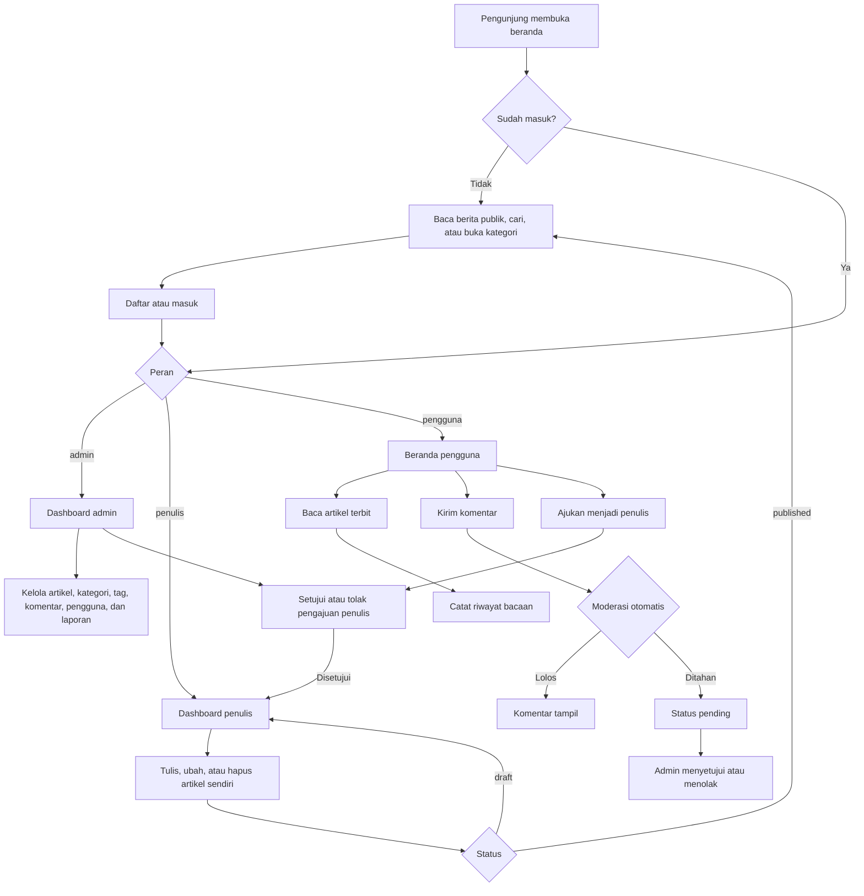
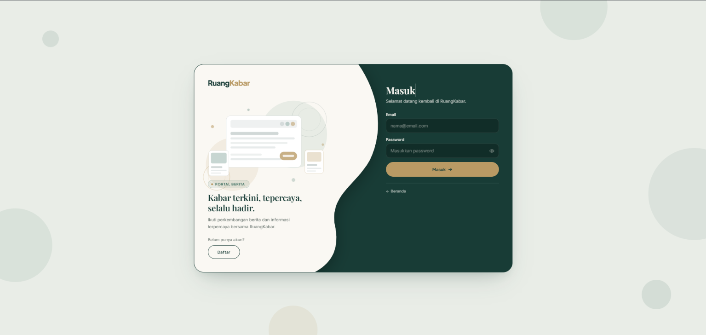
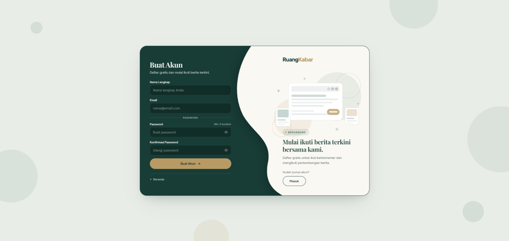
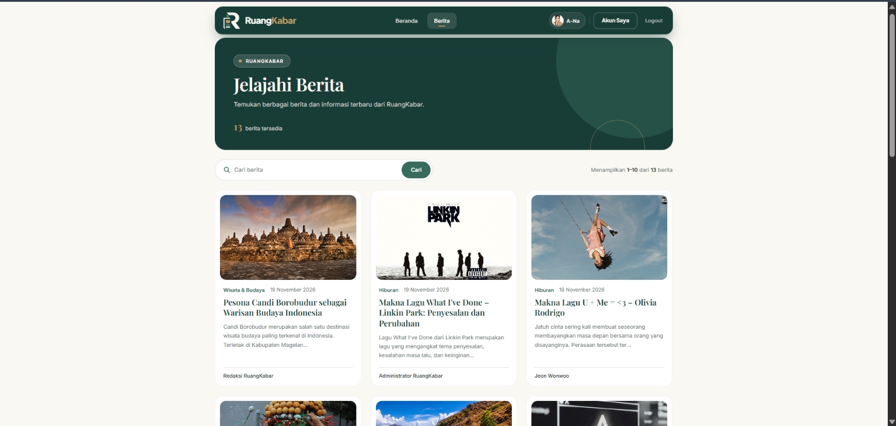
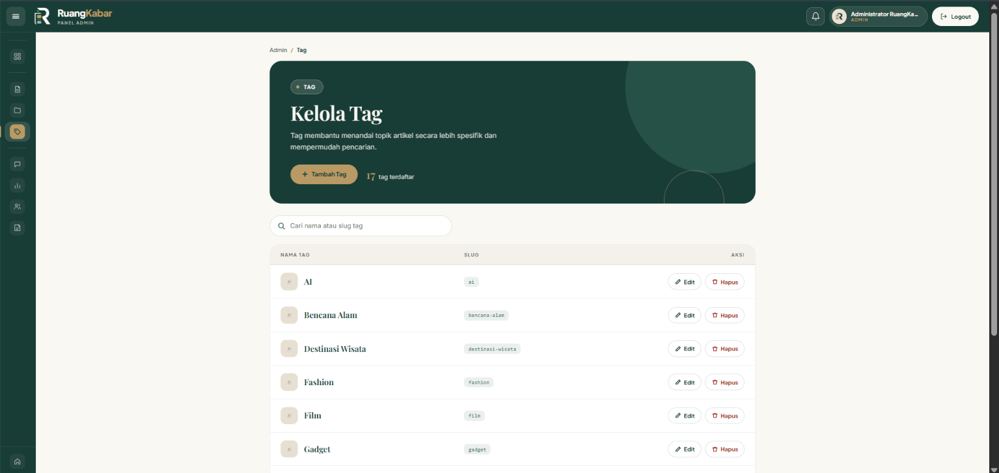
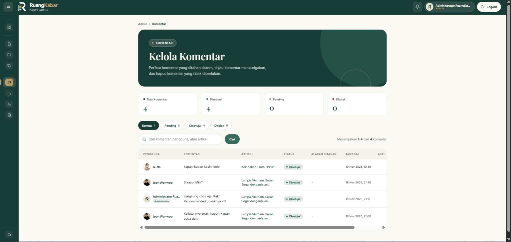
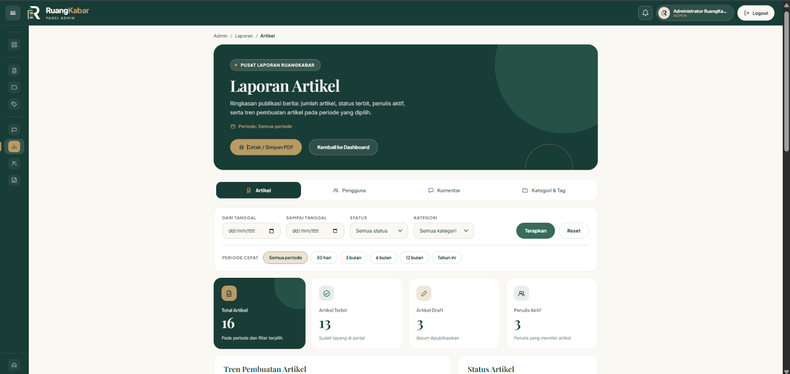
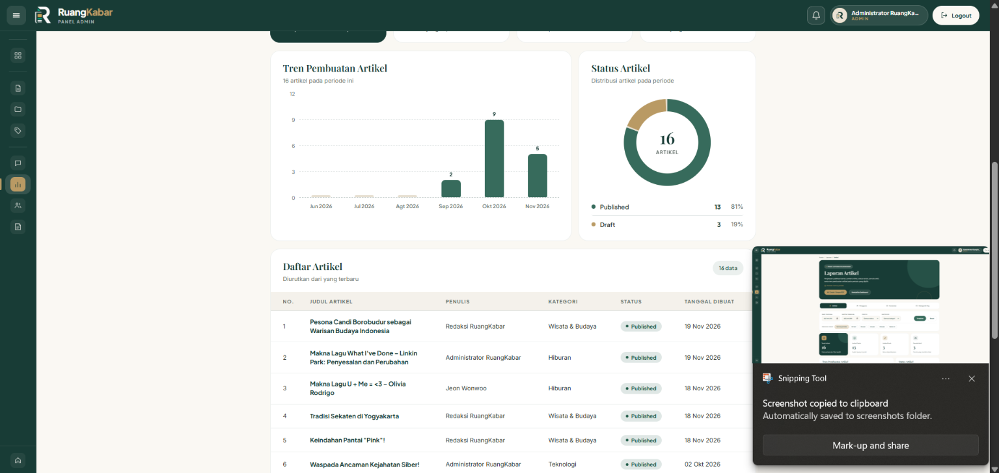

# RuangKabar

RuangKabar adalah portal berita berbasis web yang dibangun dengan Laravel. Aplikasi ini menampilkan berita kepada pembaca, menyediakan ruang tulis bagi penulis, dan menyediakan panel pengelolaan bagi administrator.

## Daftar isi

1. [Gambaran umum](#gambaran-umum)
2. [Tujuan pengembangan](#tujuan-pengembangan)
3. [Fitur utama](#fitur-utama)
4. [Hak akses dan peran pengguna](#hak-akses-dan-peran-pengguna)
5. [Teknologi yang digunakan](#teknologi-yang-digunakan)
6. [Struktur database](#struktur-database)
7. [Relasi antartabel](#relasi-antartabel)
8. [Entity Relationship Diagram](#entity-relationship-diagram)
9. [Flowchart sistem](#flowchart-sistem)
10. [Dokumentasi tampilan aplikasi](#dokumentasi-tampilan-aplikasi)
11. [Persyaratan sistem](#persyaratan-sistem)
12. [Instalasi dan konfigurasi](#instalasi-dan-konfigurasi)
13. [Menjalankan aplikasi](#menjalankan-aplikasi)
14. [Struktur direktori penting](#struktur-direktori-penting)
15. [Penutup](#penutup)

## Gambaran umum

RuangKabar memisahkan pengalaman pengguna menjadi halaman publik dan area yang memerlukan masuk. Pengunjung dapat membaca berita yang berstatus terbit, mencari judul atau isi berita, serta membuka berita berdasarkan kategori. Pengguna yang sudah masuk dapat memberi komentar, melihat riwayat bacaan, mengatur akun, dan mengajukan diri menjadi penulis.

Penulis mengelola artikel miliknya, termasuk menyimpan draf dan menerbitkan tulisan. Administrator mengelola seluruh artikel, kategori, tag, komentar, pengguna, pengajuan penulis, serta laporan ringkas portal.

Peran disimpan pada kolom `users.role` dengan tiga nilai: `admin`, `penulis`, dan `pengguna`. Pembatasan rute memakai middleware `role` pada `App\Http\Middleware\RoleMiddleware`.

## Tujuan pengembangan

- Menyediakan portal berita yang dapat dibaca tanpa harus masuk, dengan beranda, daftar berita, halaman kategori, dan halaman detail.
- Memberi penulis sarana untuk menulis, mengubah, dan menghapus artikel miliknya.
- Memberi administrator kendali atas konten, taksonomi, komentar, akun, dan laporan.
- Menjaga komentar melalui moderasi otomatis dan peninjauan admin.
- Mencatat aktivitas pembaca, seperti riwayat bacaan dan pemberitahuan di dalam aplikasi.

## Fitur utama

| Area | Fitur yang tersedia |
| --- | --- |
| Publik | Beranda enam berita terbaru, slider berita utama, pencarian, filter kategori, daftar berita, dan halaman detail |
| Akun | Daftar, masuk, keluar, ubah profil, foto profil, ubah kata sandi, dan hapus akun |
| Pembaca | Beranda pengguna, komentar, balasan komentar, riwayat bacaan, dan pengajuan menjadi penulis |
| Penulis | Dashboard produktivitas, daftar artikel sendiri, serta buat, ubah, dan hapus artikel |
| Admin | Dashboard, pengelolaan artikel, kategori, tag, komentar, pengguna, pengajuan penulis, dan laporan |
| Moderasi | Komentar dapat langsung disetujui atau ditahan sebagai `pending` bila terindikasi kata kasar, spam, tautan, atau pola lain pada `config/moderation.php` |
| Pemberitahuan | Notifikasi basis data untuk komentar, balasan, keputusan pengajuan penulis, dan aktivitas terkait |

Status artikel yang dipakai aplikasi adalah `draft` dan `published`. Hanya artikel `published` yang tampil di halaman publik. Status komentar adalah `pending`, `approved`, dan `rejected`. Komentar tingkat atas hanya dapat dikirim oleh peran `pengguna`. Balasan dapat dikirim oleh `admin`, `penulis`, dan `pengguna`, dan hanya pada komentar induk yang sudah disetujui.

Laporan admin mencakup empat jenis: artikel, pengguna, komentar, serta kategori dan tag. Laporan dapat disaring menurut periode dan filter tambahan, lalu dicetak atau disimpan sebagai PDF melalui dialog cetak peramban.

## Hak akses dan peran pengguna

Pendaftaran selalu membuat akun dengan peran `pengguna`. Setelah masuk, admin diarahkan ke `/admin/dashboard`, penulis ke `/penulis/dashboard`, dan pengguna ke `/beranda`.

### Admin

Admin masuk ke panel dengan menu dashboard, artikel, kategori, tag, komentar, laporan, pengguna, dan pengajuan penulis.

- Melihat ringkasan jumlah artikel, kategori, tag, komentar, dan pengguna.
- Mengelola seluruh artikel: cari, saring, tambah, ubah, dan hapus.
- Mengelola kategori, termasuk mengaktifkan atau menonaktifkan kategori. Kategori nonaktif tidak ditawarkan saat menulis artikel dan tidak ditampilkan sebagai kategori publik.
- Mengelola tag dan menghubungkannya ke artikel melalui tabel `article_tags`.
- Meninjau komentar, mengubah status, dan menghapus komentar.
- Mengelola pengguna: ubah nama dan peran, mengaktifkan atau menonaktifkan akun, mengatur ulang kata sandi, dan menghapus akun.
- Menyetujui atau menolak pengajuan penulis. Persetujuan mengubah peran pemohon menjadi `penulis`.
- Membuka laporan dan mencetaknya.

Kelas `App\Http\Middleware\EnsureAccountIsActive` tersedia untuk mengeluarkan akun yang `is_active` bernilai tidak aktif. Kelas ini belum didaftarkan pada pipeline middleware di `bootstrap/app.php`, dan proses masuk di `AuthController` belum memeriksa kolom tersebut. Status aktif tetap tersimpan dan dapat diubah dari halaman pengelolaan pengguna.

### Penulis

Penulis mengelola tulisan miliknya.

- Melihat dashboard jumlah artikel, artikel terbit, draf, dan grafik produktivitas.
- Melihat daftar artikel sendiri, lalu membuat, mengubah, dan menghapus artikel tersebut.
- Menentukan kategori, tag, gambar, serta status `draft` atau `published`.
- Menerima pemberitahuan ketika orang lain mengomentari atau membalas pada artikel miliknya.
- Membalas komentar yang sudah disetujui.

Penulis tidak dapat mengubah artikel milik pengguna lain. Permintaan tersebut ditolak dengan status 403.

### Pengguna

Pengguna adalah pembaca yang sudah memiliki akun.

- Membaca berita publik dan membuka beranda akun.
- Melihat aktivitas komentar dan riwayat bacaan. Riwayat dicatat ketika pengguna membuka artikel berstatus `published`.
- Menulis komentar dan membalas komentar yang sudah disetujui.
- Mengajukan diri menjadi penulis dengan alasan minimal 20 karakter. Pengajuan ganda yang masih `pending` ditolak.
- Mengatur profil, foto, kata sandi, dan penghapusan akun.
- Menerima pemberitahuan jika komentar menunggu moderasi, disetujui, ditolak, dibalas, atau jika pengajuan penulis diputuskan.

## Teknologi yang digunakan

| Komponen | Versi atau paket pada proyek |
| --- | --- |
| Bahasa | PHP `^8.3` |
| Kerangka kerja | Laravel `^13.17` (`laravel/framework`) |
| Basis data berjalan | MySQL, basis data `ruangkabar` |
| Antarmuka | Blade, Tailwind CSS `^4`, Vite `^8` |
| Plugin aset | `laravel-vite-plugin`, `@tailwindcss/vite` |
| Autentikasi | Sesi Laravel dan `Auth::attempt` berdasarkan email serta kata sandi |
| Pemberitahuan | Kanal `database` pada tabel `notifications` |
| Moderasi komentar | `App\Services\CommentModerator` dan `config/moderation.php` |

Perintah bawaan `composer run dev` memanggil `php artisan dev`. Aset front end dikompilasi dengan `npm run dev` atau `npm run build`.

## Struktur database

Skema di bawah ini mengikuti basis data MySQL `ruangkabar` yang sedang dipakai aplikasi, bukan hanya berkas migration. Tabel `users` tidak memiliki kolom `updated_at`. Model `User` juga menonaktifkan stempel waktu pembaruan.

Migration Laravel pada repositori ini tidak membuat seluruh tabel inti dari nol. Berkas migration membuat atau mengubah `author_applications`, `reading_histories`, `notifications`, serta sebagian kolom pada tabel yang sudah ada. Tabel `articles`, `categories`, `tags`, `comments`, dan `article_tags` sudah ada di basis data dan hanya diubah oleh migration lanjutan. Karena itu, `php artisan migrate` pada basis data kosong tidak membentuk skema RuangKabar yang utuh.

### users

| Kolom | Tipe | Keterangan |
| --- | --- | --- |
| id | int, kunci utama | Identitas pengguna |
| name | varchar(100) | Nama lengkap |
| email | varchar(255), unik | Dipakai untuk masuk |
| profile_photo | varchar(255), boleh kosong | Path berkas di disk `public` |
| password | varchar(255) | Disimpan dalam bentuk hash |
| role | enum `admin`, `penulis`, `pengguna` | Peran akses |
| is_active | tinyint(1), bawaan `1` | Status akun |
| created_at | timestamp | Waktu pembuatan akun |

### categories

| Kolom | Tipe | Keterangan |
| --- | --- | --- |
| id | int, kunci utama | Identitas kategori |
| name | varchar(100) | Nama kategori |
| slug | varchar(100), unik | Dipakai pada URL `/kategori/{slug}` |
| is_active | tinyint(1), bawaan `1` | Kategori aktif atau nonaktif |

Tabel ini tidak memakai `created_at` dan `updated_at`.

### tags

| Kolom | Tipe | Keterangan |
| --- | --- | --- |
| id | int, kunci utama | Identitas tag |
| name | varchar(100), unik | Nama tag |
| slug | varchar(100), unik | Slug tag |

Tabel ini tidak memakai stempel waktu.

### articles

| Kolom | Tipe | Keterangan |
| --- | --- | --- |
| id | int, kunci utama | Identitas artikel |
| category_id | int, wajib | Kategori artikel |
| user_id | int, wajib | Penulis atau admin pembuat |
| title | varchar(255) | Judul |
| slug | varchar(255), unik | Slug artikel |
| content | text | Isi berita |
| image | varchar(255), boleh kosong | Path gambar di disk `public` |
| status | enum `draft`, `published` | Status publikasi |
| created_at, updated_at | timestamp | Stempel waktu |

Migration `2026_11_18_221221_make_articles_user_id_nullable` tercatat sudah dijalankan, tetapi pada basis data saat ini `articles.user_id` masih wajib diisi dan aturan hapus kunci asingnya `RESTRICT`.

### article_tags

Tabel penghubung artikel dan tag. Kunci utamanya gabungan `article_id` dan `tag_id`. Tidak ada kolom tambahan.

### comments

| Kolom | Tipe | Keterangan |
| --- | --- | --- |
| id | int, kunci utama | Identitas komentar |
| article_id | int | Artikel yang dikomentari |
| parent_id | int, boleh kosong | Komentar induk untuk balasan |
| user_id | int | Penulis komentar |
| comment | text | Isi komentar |
| status | enum `pending`, `approved`, `rejected` | Hasil moderasi |
| flag_reason | text, boleh kosong | Alasan penahanan |
| created_at, updated_at | timestamp | Stempel waktu |

Balasan hanya mengacu ke komentar induk. Balasan tidak memiliki balasan berlapis lagi pada validasi pengiriman.

### author_applications

| Kolom | Tipe | Keterangan |
| --- | --- | --- |
| id | bigint unsigned, kunci utama | Identitas pengajuan |
| user_id | int | Pemohon |
| reason | text | Alasan pengajuan |
| status | enum `pending`, `approved`, `rejected` | Status keputusan, bawaan `pending` |
| reviewed_by | int, boleh kosong | Admin peninjau |
| admin_note | text, boleh kosong | Catatan saat ditolak |
| reviewed_at | timestamp, boleh kosong | Waktu peninjauan |
| created_at, updated_at | timestamp, boleh kosong | Stempel waktu |

### reading_histories

| Kolom | Tipe | Keterangan |
| --- | --- | --- |
| id | int unsigned, kunci utama | Identitas riwayat |
| user_id | int | Pembaca |
| article_id | int | Artikel yang dibaca |
| last_read_at | timestamp | Waktu baca terakhir |

Pasangan `user_id` dan `article_id` bersifat unik, sehingga pembacaan ulang memperbarui waktu terakhir.

### notifications

Tabel notifikasi bawaan Laravel: `id` (char 36), `type`, `notifiable_type`, `notifiable_id`, `data`, `read_at`, `created_at`, dan `updated_at`.

Tabel kerangka Laravel lain seperti `migrations` ikut tersimpan. Konfigurasi berjalan memakai `SESSION_DRIVER=file` dan `CACHE_STORE=file`, sehingga tabel sesi dan cache tidak diperlukan untuk konfigurasi tersebut.

## Relasi antartabel

| Relasi | Kardinalitas | Aturan hapus yang tercatat |
| --- | --- | --- |
| `categories.id` → `articles.category_id` | Satu kategori memiliki banyak artikel | `RESTRICT` |
| `users.id` → `articles.user_id` | Satu pengguna memiliki banyak artikel | `RESTRICT` |
| `articles.id` ↔ `tags.id` lewat `article_tags` | Banyak ke banyak | Hapus artikel menghapus baris penghubung (`CASCADE` pada `article_id`) |
| `articles.id` → `comments.article_id` | Satu artikel memiliki banyak komentar | `RESTRICT` |
| `users.id` → `comments.user_id` | Satu pengguna memiliki banyak komentar | `RESTRICT` |
| `comments.id` → `comments.parent_id` | Satu komentar memiliki banyak balasan | `CASCADE` |
| `users.id` → `author_applications.user_id` | Satu pengguna memiliki banyak pengajuan | `CASCADE` |
| `users.id` → `author_applications.reviewed_by` | Satu admin meninjau banyak pengajuan | `SET NULL` |
| `users.id` → `reading_histories.user_id` | Satu pengguna memiliki banyak riwayat | `CASCADE` |
| `articles.id` → `reading_histories.article_id` | Satu artikel memiliki banyak riwayat | `CASCADE` |

Notifikasi tidak memiliki kunci asing ke `users`. Penerima disimpan secara polimorfik pada `notifiable_type` dan `notifiable_id`.

## Entity Relationship Diagram

Diagram berikut diambil dari basis data `ruangkabar` dan disimpan di `docs/ERD.png`.


*Gambar 1. ERD RuangKabar: pengguna, artikel, kategori, tag, komentar, pengajuan penulis, riwayat bacaan, dan notifikasi.*

Folder `docs` tidak berisi berkas flowchart terpisah. Alur pada bagian berikutnya disusun dari rute dan controller yang ada di proyek.

## Flowchart sistem



Alur singkat menurut peran:

1. Pengunjung membaca artikel `published` tanpa akun.
2. Pendaftaran membuat peran `pengguna`, lalu sesi langsung dibuat.
3. Pengguna yang membuka artikel terbit menambah atau memperbarui `reading_histories`.
4. Komentar pengguna dianalisis `CommentModerator`. Hasil bersih berstatus `approved`. Hasil yang ditandai berstatus `pending` dan menunggu admin.
5. Pengguna mengirim pengajuan penulis. Admin menyetujui, lalu peran menjadi `penulis`, atau menolak dan peran tetap `pengguna`.
6. Penulis dan admin menyimpan artikel sebagai draf atau langsung menerbitkan.

## Dokumentasi tampilan aplikasi

Cuplikan berikut berasal dari berkas di folder `docs`. Tangkapan dikelompokkan menurut halaman, bukan menurut urutan nama berkas.

Nama `docs/login.png` dan `docs/register.png` semula tertukar dengan isinya. Kedua berkas sudah ditukar agar nama sesuai halaman yang tampil. Berkas gambar tidak dihapus.

### Autentikasi



*Gambar 2. Halaman masuk. Pengguna mengisi email dan kata sandi, dengan tautan ke pendaftaran dan beranda.*



*Gambar 3. Halaman daftar. Formulir meminta nama lengkap, email, kata sandi, dan konfirmasi kata sandi.*

### Halaman publik


*Gambar 4. Beranda publik: navigasi, slider berita utama, pencarian, dan pintasan kategori.*



*Gambar 5. Halaman jelajah berita. Kartu menampilkan gambar, kategori, tanggal, judul, ringkasan, dan nama penulis.*


*Gambar 6. Halaman detail berita: judul, penulis, tanggal, estimasi baca, dan isi artikel.*

### Area pengguna


*Gambar 7. Beranda peran pengguna: aktivitas komentar, riwayat bacaan, dan berita terbaru.*


*Gambar 8. Pengaturan akun: foto profil, nama, serta informasi email, peran, dan tanggal bergabung.*

### Area penulis


*Gambar 9. Dashboard penulis: ringkasan artikel terbit dan draf, serta grafik produktivitas.*


*Gambar 10. Daftar artikel penulis, dengan pencarian, saringan status, dan tanggal publikasi.*

### Area admin


*Gambar 11. Dashboard admin: sambutan, ringkasan jumlah konten, dan pintu masuk laporan.*


*Gambar 12. Bagian bawah dashboard admin: grafik publikasi, status artikel, daftar artikel terbaru, dan kategori terpopuler.*


*Gambar 13. Pengelolaan artikel admin untuk seluruh tulisan, dengan saringan status dan kategori.*


*Gambar 14. Pengelolaan kategori: slug, status aktif, serta aksi nonaktifkan, ubah, dan hapus.*



*Gambar 15. Pengelolaan tag beserta slug dan aksi ubah atau hapus.*



*Gambar 16. Moderasi komentar: jumlah disetujui, pending, dan ditolak, serta alasan penahanan.*


*Gambar 17. Pengelolaan pengguna menurut peran dan status akun.*



*Gambar 18. Laporan artikel: pilihan jenis laporan, rentang tanggal, dan kartu ringkasan.*



*Gambar 19. Lanjutan laporan artikel: tren pembuatan, diagram status, dan tabel daftar artikel. Pada tepi kanan cuplikan ikut terlihat jendela Snipping Tool sistem operasi.*

## Persyaratan sistem

- PHP 8.3 atau lebih baru, dengan ekstensi yang dibutuhkan Laravel, termasuk `pdo_mysql`, `mbstring`, `openssl`, `tokenizer`, `xml`, `ctype`, `json`, `fileinfo`, dan `bcmath`.
- Composer.
- Node.js dan npm untuk Vite serta Tailwind CSS.
- MySQL atau MariaDB yang kompatibel dengan MySQL.
- Server web yang mengarah ke folder `public`, atau server bawaan `php artisan serve`.

Lingkungan pengembangan proyek ini memakai PHP 8.3, MySQL di `127.0.0.1` port `3306`, basis data `ruangkabar`, dan akun basis data `root`.

## Instalasi dan konfigurasi

Ganti `<url-repository>` dengan alamat repositori yang sebenarnya. Alamat tersebut belum tercatat di proyek.

### 1. Ambil kode sumber

```bash
git clone <url-repository> ruangkabar
cd ruangkabar
```

### 2. Pasang dependensi PHP

```bash
composer install
```

Jangan memakai `composer run setup` sebagai satu-satunya langkah pada basis data kosong. Skrip tersebut menyalin `.env`, membuat kunci, lalu langsung menjalankan `php artisan migrate --force`. Migration di repositori ini tidak cukup untuk membentuk skema RuangKabar dari nol.

### 3. Pasang dependensi Node

```bash
npm install
```

### 4. Siapkan berkas lingkungan

```bash
copy .env.example .env
php artisan key:generate
```

Pada Linux atau macOS, gunakan `cp .env.example .env`.

Berkas `.env.example` masih memakai bawaan kerangka Laravel: `DB_CONNECTION=sqlite`, `SESSION_DRIVER=database`, `CACHE_STORE=database`, dan `FILESYSTEM_DISK=local`. Konfigurasi yang dipakai aplikasi ini berbeda. Sesuaikan `.env` menjadi:

```dotenv
APP_NAME=RuangKabar
APP_ENV=local
APP_DEBUG=true
APP_URL=http://localhost:8000

DB_CONNECTION=mysql
DB_HOST=127.0.0.1
DB_PORT=3306
DB_DATABASE=ruangkabar
DB_USERNAME=root
DB_PASSWORD=

SESSION_DRIVER=file
SESSION_LIFETIME=120

CACHE_STORE=file
QUEUE_CONNECTION=database
FILESYSTEM_DISK=public
```

Isi `DB_USERNAME` dan `DB_PASSWORD` sesuai server MySQL Anda. `APP_KEY` dihasilkan oleh `php artisan key:generate`.

### 5. Siapkan basis data MySQL

Buat basis data:

```sql
CREATE DATABASE ruangkabar CHARACTER SET utf8mb4 COLLATE utf8mb4_unicode_ci;
```

Impor cadangan basis data RuangKabar yang sudah berisi tabel inti dan data bila cadangan itu tersedia. Repositori ini tidak menyertakan berkas SQL.

`php artisan migrate` hanya aman bila tabel `users`, `articles`, `categories`, `tags`, `comments`, dan `article_tags` sudah ada dengan kolom yang diharapkan migration lanjutan. Pada basis data kosong, migration awal membuat tabel `users` bawaan Laravel, lalu migration berikutnya gagal karena mencari kolom `username` atau `role` dan tabel `articles`, `categories`, serta `comments` yang tidak dibuat di migration mana pun.

Jika basis data sudah sesuai ERD dan tabel `migrations` belum memuat migration baru, jalankan:

```bash
php artisan migrate
```

Jika struktur dan data sudah lengkap serta seluruh migration sudah tercatat, langkah ini tidak perlu diulang.

### 6. Hubungkan penyimpanan publik

Foto profil dan gambar artikel disimpan ke disk `public`.

```bash
php artisan storage:link
```

Perintah ini membuat tautan `public/storage` ke `storage/app/public`.

## Menjalankan aplikasi

Jalankan server Laravel:

```bash
php artisan serve
```

Aplikasi dapat dibuka di `http://localhost:8000`, sesuai `APP_URL`.

Pada terminal lain, jalankan Vite selama pengembangan agar CSS Tailwind ikut dimuat:

```bash
npm run dev
```

Untuk menyusun aset tanpa proses Vite yang terus berjalan:

```bash
npm run build
```

Jika proyek dibuka lewat Laragon atau server web lain, arahkan document root ke folder `public`, lalu sesuaikan `APP_URL` dengan alamat host tersebut.

Akun admin, penulis, dan pengguna tidak dibuat oleh `DatabaseSeeder`. Seeder bawaan hanya menyiapkan satu pengguna uji `test@example.com` dan tidak mengisi kolom `role` yang wajib pada skema ini. Akun awal perlu dibuat langsung di tabel `users` dengan peran yang valid, atau didaftarkan lewat halaman `/register` untuk peran `pengguna`.

Halaman yang dapat dibuka setelah aplikasi berjalan:

| Halaman | URL | Peran |
| --- | --- | --- |
| Beranda | `/` | Publik |
| Daftar berita | `/articles` | Publik |
| Detail berita | `/articles/{id}` | Publik untuk artikel terbit |
| Kategori | `/kategori/{slug}` | Publik |
| Masuk | `/login` | Tamu |
| Daftar | `/register` | Tamu |
| Beranda pengguna | `/beranda` | `pengguna` |
| Pengaturan akun | `/pengaturan-akun` | Semua peran yang masuk |
| Dashboard penulis | `/penulis/dashboard` | `penulis` |
| Artikel penulis | `/penulis/articles` | `penulis` |
| Dashboard admin | `/admin/dashboard` | `admin` |
| Laporan | `/reports/articles` | `admin` |

## Struktur direktori penting

```text
app/
├── Http/
│   ├── Controllers/          Controller publik, penulis, admin, akun, dan laporan
│   │   └── Admin/            Pengelolaan pengguna dan pengajuan penulis
│   └── Middleware/           RoleMiddleware dan EnsureAccountIsActive
├── Models/                   User, Article, Category, Tag, Comment, AuthorApplication, ReadingHistory
├── Notifications/            Pemberitahuan komentar dan pengajuan penulis
└── Services/                 Moderasi komentar
bootstrap/app.php             Alias middleware role
config/moderation.php         Ambang dan pola moderasi komentar
database/migrations/          Perubahan skema, bukan skema inti yang utuh
resources/views/              Blade publik, autentikasi, penulis, dan admin
routes/web.php                Seluruh rute web
docs/                         ERD dan cuplikan layar
public/                       Titik masuk HTTP dan aset publik
storage/app/public/           Gambar artikel dan foto profil
```

## Penutup

RuangKabar menggabungkan portal baca, ruang tulis, dan panel admin dalam satu aplikasi Laravel. Hak akses mengikuti tiga peran pada tabel `users`, sedangkan konten publik hanya menampilkan artikel berstatus `published`.

Dokumentasi ini mengikuti kode, konfigurasi `.env` yang berjalan, skema MySQL `ruangkabar`, dan gambar di folder `docs`. Bagian yang masih perlu dilengkapi di luar repositori adalah alamat repositori dan cadangan SQL apabila instalasi dilakukan pada basis data yang masih kosong.
